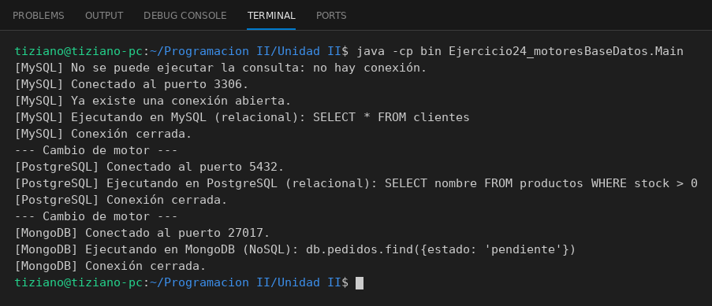

# ConexionBD

Programación II - Unidad 2 - Ejercicio 24

## Consigna
Una aplicación usa motores de base de datos intercambiables a través de una interfaz de conexión.

## Lógica
- Interfaz `ConexionBD` con `conectar()`, `ejecutarConsulta(String)` y `desconectar()`.
- `ConexionMySQL`, `ConexionPostgreSQL` y `ConexionMongoDB` mantienen un flag `conectada`.
- Validaciones de estado: no se ejecuta una consulta sin conexión, no se conecta dos veces y no se cierra una conexión inexistente.
- `Main`: una única variable de tipo interfaz a la que se asignan los tres motores.

## Ejecución

